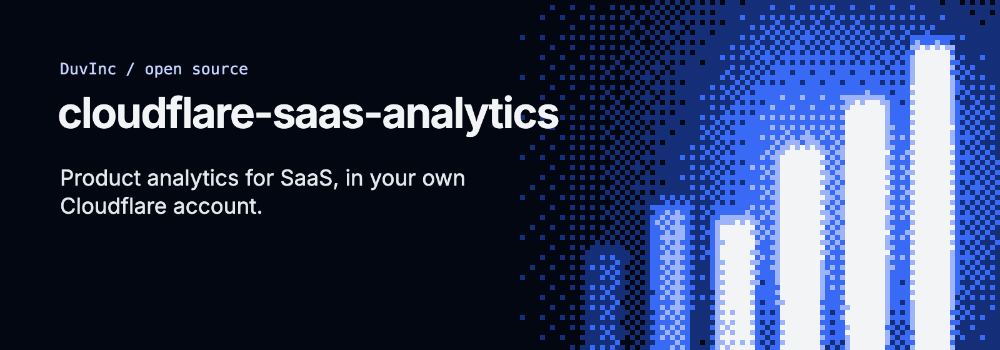
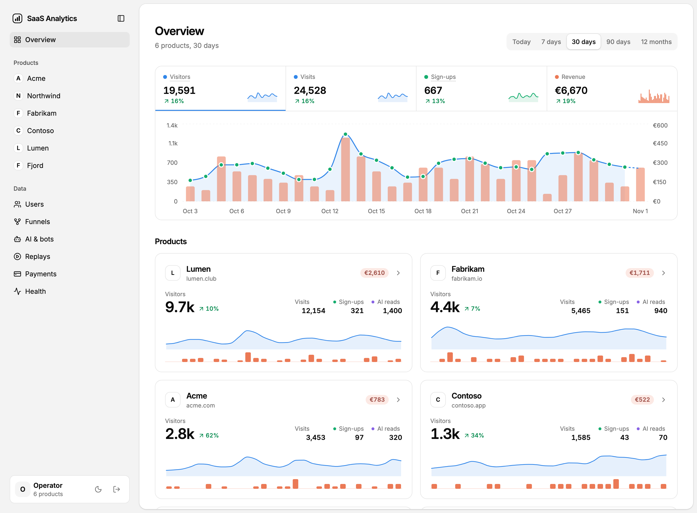
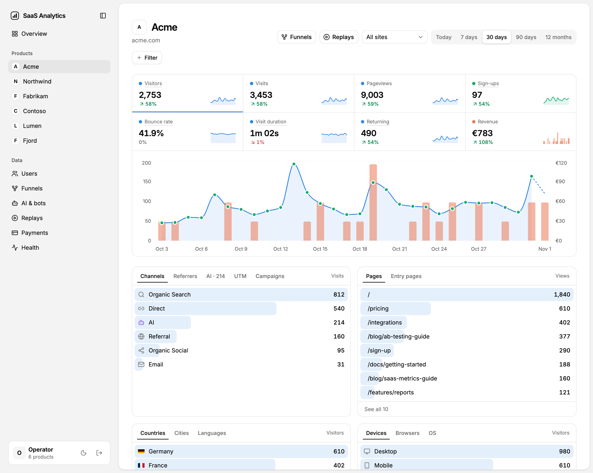
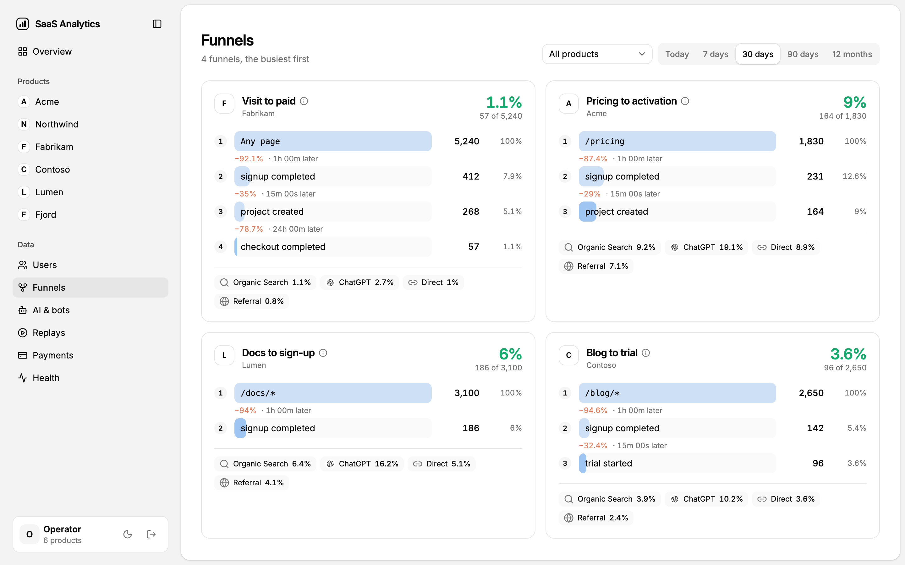
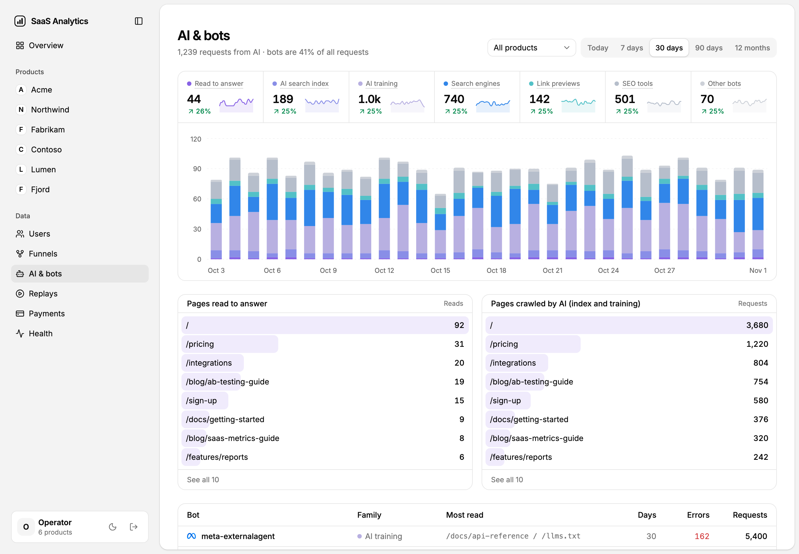
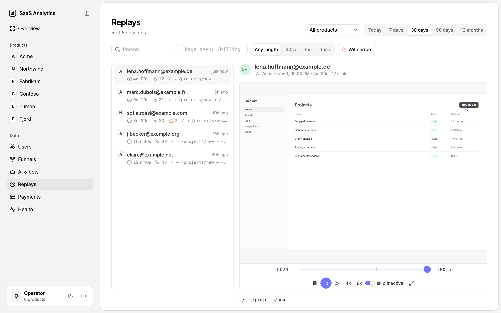

# cloudflare-saas-analytics



**Your SaaS already runs on Cloudflare. Your analytics should too.** Web analytics, product events, funnels, signup attribution, Stripe revenue and session replay, in one Worker in your own account, with no third-party script and no per-seat bill.

> **Early.** This was built for a handful of real products, then pulled out of them. It works in production, the rough edges are known and listed below, and it will change. If something is unclear, missing or wrong, [open an issue or a discussion](https://github.com/DuvInc/cloudflare-saas-analytics/discussions): early feedback shapes what comes next.

```html
<!-- On every page of your site or app. 1.3 KB gzipped, writes nothing on the device. -->
<script defer src="https://t.example.com/t.js"></script>
```

```ts
// In your product's Worker (service binding, no HTTP, no secret):
ctx.waitUntil(env.ANALYTICS.identify({ userId: user.id, email: user.email, createdAt: user.createdAt, signup: true, seen: seenFrom(request.headers) }));
ctx.waitUntil(env.ANALYTICS.track({ event: "project_created", userId: user.id }));
//   -> the account is linked to the visit that brought it: "signed up from ChatGPT, first seen on /blog/guide"
```

```bash
npm run csa -- channels --product acme
# channel          ai       visits  signed_up  conv_pct  paying  revenue
# Organic Search            1,840   42         2.3       6       540
# AI               ChatGPT  310     19         6.1       4       380
# Direct                    1,120   11         1.0       1       90
```

(The numbers above are invented. Everything else on this page is measured or marked as not measured yet.)



## What you get

| | |
| :--- | :--- |
| **Web analytics** | Page views, visitors, sources, countries, devices, Web Vitals. Acquisition channels follow the usual rules (paid, organic search, social, email, referral, direct) plus one most tools lack: **AI assistants** (ChatGPT, Perplexity, Claude, Gemini, Copilot...) as a channel of their own. |
| **Product events and funnels** | `track` from your server or the browser. Funnels are defined in code (`config/funnels/*.json`), measure people in order, and join anonymous landings to the account they became. |
| **Attribution** | A signup is tied to the first visit that brought the person: by a consent cookie, or by a daily hash of IP and browser that is deleted after 48 hours. Never overwrites an existing origin, never attributes a visit after the signup. |
| **Revenue** | Stripe, read only (webhooks plus a nightly reconciliation). Revenue per channel, per AI assistant, per person. A one-off Checkout and the invoice Stripe generates for it count once. |
| **Session replay** | Signed-in users only, masked by default, stored 30 days. A player in the dashboard. |
| **AI and bots** | Which verified AI crawlers read which pages, hourly, from Cloudflare's own zone analytics. Optional. |
| **Reports and alerts** | Daily, weekly and monthly reports to a Slack or Discord webhook; alerts when a product goes silent or a job fails. |
| **A dashboard on your phone** | Passkey sign-in only (no password, no third party), installable as a PWA. |
| **A CLI for agents** | `csa` runs every query locally in DuckDB, free, whatever the SQL. [SCHEMA.md](SCHEMA.md) documents every column. |

### The screens

All screenshots show invented data, rendered from the real dashboard (`npm run screenshots` regenerates them).

| | |
| :--- | :--- |
|  |  |
| **A product.** Every row is a filter: click "Organic Search" and the whole screen shows only those visits. | **Funnels.** Defined in code, measured on people in order, with the conversion by channel and AI assistant. |
|  |  |
| **AI and bots.** Which AI crawlers read which pages, and which AI answers fetched them live. | **Replays.** Sessions of signed-in users, worst first (errors, then length), played in the dashboard. |

## Why it is built this way

- **Privacy by construction.** No IP address is stored. A visitor is anonymous (level 0: a hash that changes every UTC day) until they say yes to your consent banner (level 1: a cookie) or sign in (level 2). Do Not Track and Global Privacy Control win over everything. A site that never asks for consent still gets page views, sources and funnels, just not a returning-visitor identity.
- **Cheap by construction.** D1 only holds small tables: a row per product per day, per person, per payment. Raw events are files in R2, compacted once a day, and the dashboard reads compacted data. A page view never becomes a row you pay to read.
- **Bounded by construction.** Rate limits per IP and per product, 32 KB per request, 25 hits per request, bounded gzip, 512 KB per replay chunk. A runaway has a ceiling you can compute (below).

## How it works

```text
browser   t.<domain>/t.js ──POST /e──┐
          replay.js (signed-in) ─POST /r─┤
your Worker ── env.ANALYTICS (RPC) ──────┤        this Worker
Stripe ── webhook /stripe/<product> ─────┤  ───►  ├─ Pipelines stream ─► R2 raw/*.json.gz (every 5 min)
                                                  ├─ R2 replays/<product>/<day>/<session>/*.json.gz (30 days)
                                                  └─ D1: days, people, identities, payments, replay_sessions, runs
hourly cron :17   settled hours of today compacted; closed UTC day ─► R2 daily/<day>/ + D1 `days`; bots; alerts
07:17 UTC         reports (daily; Monday weekly; 1st monthly)
03:17 UTC         Stripe reconciliation
```

The decision that shapes the rest: **events are written once to a Cloudflare Pipelines stream** (batched into R2 every five minutes) rather than one D1 row or one R2 object per hit. Writes cost almost nothing and survive a traffic spike; the price is that today's numbers lag by up to five minutes, and Pipelines needs the Workers Paid plan. The alternative, a Durable Object or R2 write per batch, is described under "Running it on the free plan".

The dashboard is a React app in `web/` served by the same Worker, on `workers.dev` only. Collection answers on your own hosts (`t.example.com`): first-party, so no third-party domain to list. Content blockers can still match the script name or path, so expect some undercount.

### Compacted storage

New closed days use Brotli level 4, partitioned by product under
`daily/<day>/product=<URL-encoded-id>/part-NNN.ndjson.br`. The existing `runs.files`
manifest remains the source of truth and is published only after all parts and D1 rows succeed.
Product-specific filters, activity and funnels fetch only that product's parts. Account-wide
queries still read every product. A missing committed part raises an error rather than returning
an incomplete result; unfinished partitions without a successful manifest fall back to raw data.

New settled hourly files use `.ndjson.br`; existing `.ndjson.gz` hours and historical mixed
daily gzip files remain readable and are not rewritten. The CLI decompresses either format
into private temporary files inside `.archive/events/`, atomically replaces the local Parquet,
and cleans staging after success or failure. Bots, replays, collection, retention and D1 schema
are unchanged. There is no new service or subscription. Partitioning adds one PUT per product
part instead of one mixed part and can add GETs to account-wide reads.

Deploy readers and CLI together with the new writer. A rollback after the first Brotli write
must retain Brotli readers; do not roll back to an older gzip-only Worker or CLI. Reverting the
writer to gzip is safe while keeping both readers. No historical backfill is needed.

## Try it

**Look first, no account.** The dashboard runs against invented data:

```bash
git clone git@github.com:DuvInc/cloudflare-saas-analytics.git && cd cloudflare-saas-analytics
npm ci
npm run check            # types and tests, no network
MOCK=1 npm run dev:web   # the dashboard on :5199 with made-up data, no passkey
```

**Install it in your Cloudflare account.** You need the Workers Paid plan, a zone for each product, and `npx wrangler login` done once.

```bash
npm run setup -- --dry-run   # prints every command and the config it would write, changes nothing
npm run setup                # creates D1, R2, KV, the Pipelines stream; deploys; sets the two secrets
npm run csa -- enroll        # a link to register your first passkey on your phone or laptop
```

`setup` is a convenience over commands you can run yourself (they are all in `scripts/setup.mjs`). It has been planned in a dry run and each command checked against the current Wrangler, but it has not been run end to end by anyone but its author yet: if a step fails, the error and the state file `.setup-state.json` tell you where, and a re-run resumes. That is the kind of feedback this release is for.

Then put the tracker on each site, and for each zone add the WAF rule below.

## Putting it in your product

**The site.** The `<script>` tag above. With a consent banner, the tracker listens for `window.csaConsent` or the `cookie-consent` event of [cloudflare-cookie-consent](https://github.com/DuvInc/cloudflare-cookie-consent), and sets its cookie only on a yes. Without one it stays at level 0.

A page the browser prerenders (speculation rules, a link hovered) is counted once it is shown; one thrown away unseen sends nothing. Replay chunks survive a page that navigates away (a checkout redirect, a reload): the last chunk leaves with `keepalive` and is kept in `sessionStorage` until the server answers, so the next page in the tab resends it. `csa replay` reports any chunk still missing instead of refusing the session.

**The app.** Bind the Worker to yours (`wrangler.jsonc` of your product):

```jsonc
"services": [{ "binding": "ANALYTICS", "service": "saas-analytics", "entrypoint": "AnalyticsService", "props": { "product": "acme" } }]
```

The product is fixed by the binding's `props`, so a product can only write as itself. `seen` is what your server saw of the browser (`{ ip: cf-connecting-ip, ua: user-agent, cookie }`); send nothing at all when the request carries Do Not Track or Global Privacy Control. Four calls, all safe to fire and forget (none throws): `identify` (the person; `signup: true` on creation attributes the signup), `track` (an event), `userToken` (a signed token for the browser, so replays and browser events carry the user), `forget` (account deleted: profile, identities and replays go).

For an account created by an OAuth return, where the sign-up webhook has no browser context, call `identify({ attributeSignup: true, seen })` from the callback that does: it fills a missing first touch for an account less than 15 minutes old, and never counts a sign-in as a sign-up.

**Your definitions.** `config/events/<product>.json` is the event catalog (names the health check will not flag, and the activation event). `config/funnels/<product>.json` are the funnels. Import both in `config/index.ts`. Products themselves are in `wrangler.jsonc` `vars.PRODUCTS`.

**From a script or a workflow tool.** `POST /s` with `Authorization: Bearer <token>` (secret `SERVER_TOKENS`, a JSON map of product to token).

**Stripe.** Per product, optional: `STRIPE_WEBHOOK_SECRET_<PRODUCT>` for `POST /stripe/<product>` (events `checkout.session.completed`, `invoice.paid`, `charge.refunded`) and `STRIPE_KEY_<PRODUCT>`, a restricted key with read access, to backfill history once and reconcile nightly. Put `metadata.user_id` on the Checkout so a payment finds its person.

**Reports.** Secrets `REPORT_WEBHOOK_URL` and `ALERT_WEBHOOK_URL`. A Slack incoming webhook works as is; a Discord webhook works with `/slack` appended to its URL; any other URL receives the full JSON, numbers included.

**Natural-language filters** (optional). Set `AI_BASE_URL`, `AI_API_KEY` and `AI_MODEL` (any OpenAI-compatible chat endpoint) and the filter bar gets a box where you type "French traffic on my blog". Unset, the box is hidden.

**Bots** (optional). Secret `CF_ANALYTICS_TOKEN` with Zone Read and Analytics Read on your zones, and a `BOTS` var. Read [BOTS-READING.md](BOTS-READING.md) before concluding anything from these counts.

### Cloudflare WAF rule (do this)

Certificate-transparency scanners find your collection host within hours and probe `/.env`, `/swagger.json`, `/.aws/credentials`. Every probe wakes the Worker to answer 404. On the author's six hosts this was 73,900 requests in 48 hours, about 40% of the Worker's traffic. A free custom rule per zone stops them before the Worker:

```text
Action: Block
Expression: (http.host eq "t.example.com" and not http.request.uri.path in {"/e" "/r" "/t.js" "/replay.js" "/robots.txt"})
```

Scope it to the collection host, never the zone: the rest of the zone is your site. Stripe webhooks and `/s` live on the dashboard host, not on these.

## What it costs

Measured on the author's six products (about 2,500 page views a day, 27 replay sessions a day), over the first 48 hours, at catalogue prices before any free tier:

| | per 24 h | Why |
| :--- | ---: | :--- |
| R2 operations | $0.038 | 350,655 `GET` and 311,197 `LIST` over 72 h, mostly from bugs fixed since (see below) |
| D1 rows read and written | $0.010 | |
| Workers requests and CPU | $0.005 | |
| KV | $0.004 | |
| **Total** | **$0.058** | the account's largest line, at a third of its spend |

Two things to read honestly. First, those numbers include waste that was found and fixed because the first 48 hours were watched: a daily job that re-read yesterday's files 22 times, a dashboard that listed `raw/` on every cold load, an unindexed table. The fixes are in this repository; **the after-fix cost has not been measured yet**, and the expected reduction (8 to 10 times on R2 and D1 operations) is a prediction until it is. Second, a Workers Paid plan is $5 a month on top, and, at the time of writing, Pipelines output is free up to 50 GB.

**The ceiling.** Rate limits cap one product at 6,000 requests a minute, about 8.6 million a day, about $2.60 at catalogue prices. `COLLECT=off` in `wrangler.jsonc`, or `npm run csa -- kill <product>`, stops collection within a minute without a deploy.

## Running it on the free plan

Pipelines is what needs the paid plan. The Worker only calls `env.STREAM.send(records)`, so the same records can be written another way: batched into R2 by a Durable Object every minute, or as small R2 objects per request. Neither is built in this repository. If you want one, open an issue saying which; the contract is one function.

## What this is not

- **Not a PostHog or Mixpanel replacement for a product team.** No feature flags, no experiments, no surveys, no heatmaps, no session search by arbitrary property. It answers "where do my customers come from and what do they do next", for one operator, quickly.
- **Not multi-tenant.** One operator signs in with passkeys. There is no team, no roles, no sharing.
- **Not real time.** Today's figures lag by up to five minutes, and closed days are compacted overnight.
- **Not a consent banner.** It reads yours. Without one it counts, but anonymously.
- **Not battle-tested at scale.** It has served about 2,500 page views a day. It is designed to be bounded (see Spend), not proven at a million.
- **Not packaged for a one-line install yet.** `npm run setup` is the first attempt at one.

### Versus the tools you may be using

| | This | Plausible, Datafast | GA4 | PostHog |
| :--- | :--- | :--- | :--- | :--- |
| Where the data lives | your Cloudflare account | their cloud, or self-hosted | Google | their cloud, or self-hosted |
| Product events and funnels | yes, defined in code | basic or paid | yes | yes, much deeper |
| Revenue by acquisition channel | yes (Stripe) | some | with work | yes |
| AI assistants as a channel | yes | partial | no | partial |
| Session replay | yes | no | no | yes, with more tooling |
| Feature flags, experiments, surveys | no | no | partial | yes |
| Cost | Cloudflare usage + $5 plan | subscription | free | usage |

This table is the author's reading, not a benchmark: check each tool's current plan before deciding.

## Credits

Built on Cloudflare Workers, D1, R2, KV, Pipelines and the GraphQL analytics API; WebAuthn through [SimpleWebAuthn](https://simplewebauthn.dev); session recording and playback by [rrweb](https://www.rrweb.io); queries by [DuckDB](https://duckdb.org); the dashboard on [shadcn/ui](https://ui.shadcn.com) and [Recharts](https://recharts.org); Inter by Rasmus Andersson.

MIT. Contributions: [CONTRIBUTING.md](CONTRIBUTING.md) (commits signed off). Working with an AI agent in this repository: [AGENTS.md](AGENTS.md). Vulnerabilities: [SECURITY.md](SECURITY.md).
